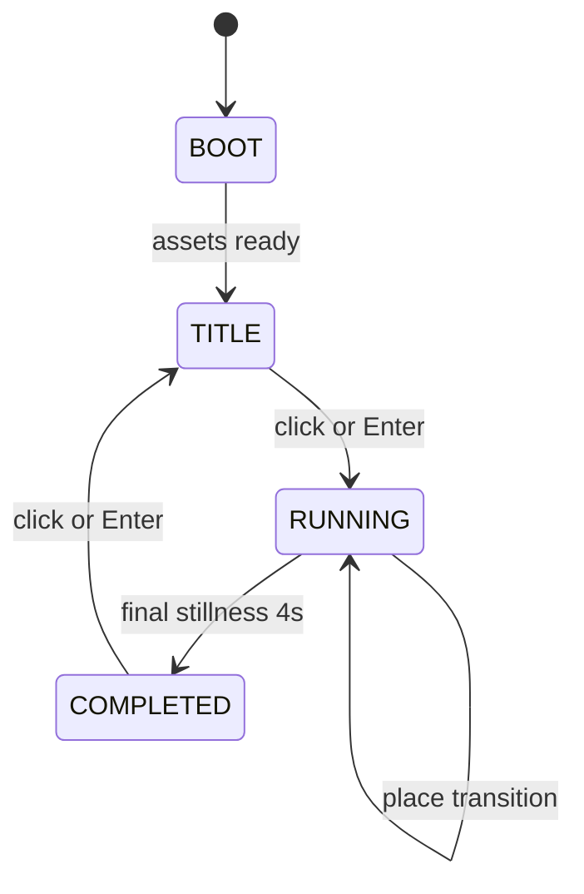

# 0. SCOPE

## 0.1 Asked

| Requirement | Where it lives |
| --- | --- |
| Browser game, agentic AI build target | `#2 CONTRACTS`, `#8 DEBUG API`, `#9 TESTS`, `#10 BUILD ORDER` |
| Platformer where the player is a frog | `#4 GAMEPLAY SPEC`, `#5 CHARACTERS` |
| Side-on 2.5D, camera low at frog scale, parallax, no map, no abstract HUD, no meters | `#3 VISUAL SPEC`, `#7 UX` |
| Real-time | `#1.1 Units, axes, frames` |
| Bounded places from wake perch to exit perch | `#4.18 Places and run structure` |
| Final true exit is the rooftop pond lily ring | `#4.19 Completion` |
| Quiet, forgiving, physical, no death, no score shame | `#4.7 Safe perch and reset`, `#4.21 Feel`, `#11 DEFINITION OF DONE` |
| Core verbs: crouch-and-release hop, tongue, tongue-swing, sticky pads, water, safe perch, danger language, cat watching/stillness | `#4.1` through `#4.9`, tagged Tier 1 |
| Supporting mechanics: yank/pull, eating reactions, cat swat, heron, sprinklers, currents/fish, object changes, brittle/moving/wind surfaces | `#4.10` through `#4.17`, tagged Tier 2 |
| Extra mechanics: none | `#0.2 Decisions`, `#4` |
| Exact content parts only | `#4.11 Content roster`, `#4.18 Places and run structure` |
| Opening phase teaches all core verbs in one sequence, then no new verbs | `#4.18 Places and run structure`, `#9 TESTS` |
| Later places more vertical, connected, direct dangerous route and longer safer route | `#4.18 Places and run structure`, `#4.20 Progression and difficulty` |
| Look and sound: rain-soaked garden/city edge, moonlit rooftop pond, quiet wet audio | `#3 VISUAL SPEC`, `#6 AUDIO` |
| No combat, no survival meters, no collectathons, no score, no open world, no locks/switches, no new verbs after opening, no death screens, no human platformer with frog costume | `#0.2 Decisions`, `#4.21 Feel`, `#7 UX`, `#11 DEFINITION OF DONE` |

## 0.2 Decisions

| Decision | Ruling | Why |
| --- | --- | --- |
| Game identity | Adopted unchanged: quiet wet frog platformer. | Final user decision. |
| Player | Nameless small wet frog. No named protagonist, no upgrades. | Keeps focus on body, reading, and movement. |
| View | Side-on 2.5D, camera low at frog scale, parallax layers, exit perch and distant rooftop pond visible as goals. | Final user decision. |
| No map, no abstract HUD, no meters | No in-game HUD. Safe perch rings, eye/throat signals, shadows, ripples, and material cues are diegetic. | Final user decision. |
| Time | Real-time fixed-step simulation. | Final user decision. |
| Run | Linear bounded places. Place begins on wake perch, ends on held exit perch, next place slides into view. | Final user decision. |
| Opening phase | Ends at Place 5, where the rooftop pond is fully visible and all core verbs are used in one sequence. After Place 5 no new verbs are introduced. | Final user decision. |
| Final completion | Final place ends only when the frog is still in the final rooftop pond lily ring for 4.0 seconds. Earlier ponds never complete. | Final user decision. |
| Tone | Quiet, wet, forgiving, physical. Failure causes embarrassment, delay, rethink. | Final user decision. |
| Look | Rain-soaked garden/city edge seen at frog scale. Moonlit rooftop pond visible as distant shape. | Final user decision. |
| Sound | Rain drips, wet thuds, tongue snaps, water, sprinkler warnings, animal cues, final frog chorus. No score music. | Final user decision. |
| Core mechanics | Exactly: crouch-and-release hop, tongue, tongue-swing, sticky pads/wet surfaces, water entry/hauling out, safe perch/reset, danger language, cat watching/stillness. These are Tier 1. | Final user decision. |
| Supporting mechanics | Exactly: tongue yank/pull, eating reactions, cat swat, heron open-ground hunt, sprinkler valves, currents/fish, object physical changes, brittle/moving/wind surfaces. These are Tier 2. | Final user decision. |
| Extra mechanics | None. No extra systems added. | Final user decision. |
| Content | Use exactly the listed parts: garden/city objects, anchors, hazards, animals, insects, surfaces, water, ponds, wind, etc. No additional pickups, coins, doors, switches, collectables, or combat enemies. | Final user decision. |
| Left out | No combat platforming, no defeating enemies, no survival meters, no collectathons, no flies as coins, no score, no open world, no abstract machine puzzles, no locked doors/switches, no new verbs after opening, no death screens, no score shame, no harsh punishment, no human platformer with frog costume. | Final user decision. |
| Units | `1 world unit = 1 frog body length = 48 px at base camera`. Physics uses units and seconds. | Gives small, readable numbers while keeping camera at frog scale. |
| Coordinate frame | `x` right, `y` up. Angles: `0°` right, `90°` up. Gravity is negative. | Keeps arc math simple and matches “up” verticality. |
| Fixed step | 60 Hz fixed update. Max 5 catch-up steps per frame. | Deterministic physics and tests. |
| RNG | Deterministic Mulberry32 seeded from a saved seed. | Reproducible hazards and tests. |
| Primary input | Mouse cursor sets tongue aim and, while crouching, sets hop aim. Left Mouse Button or `Space` holds crouch and releases hop. Right Mouse Button or `E` holds tongue and releases tongue. `A/D` or `Left/Right` are used while stuck to break grip and while swimming to steer. `W/S` or `Up/Down` are used while stuck to climb/slide and while swimming to paddle. | The game is about aim and body control, not running. Mouse aim matches “the player aims the tongue” and crouch-release aim. |
| No running | `A/D` never move the frog on land. They only break grip or steer in water. | Prevents human platformer feel. |
| Hop numbers | Charge max 0.65s, max launch speed 10.5 u/s, gravity 38 u/s², angle clamp 20°–78°, no air control. | Produces committed hops of about 1.4u height and 2.9u horizontal distance at full charge. |
| Tongue numbers | Max length 7.5u, tongue speed 20u/s, tip radius 0.22u, rope length 1.2u–7.5u. | Gives a physical, readable verb, not a magic rope. |
| Anchor strength model | Anchors have visible material, break load, hold angle tolerance, and movement mass. Strong anchors hold; weak anchors break or move. | Lets the player read guesses from texture and consequence. |
| Sticky numbers | Sticks only to damp rough porous surfaces with contact speed ≤3.5u/s and climbable angle. Climb 0.85u/s, deliberate slide 1.2u/s, idle slide 1.6u/s. Sideways input or hit breaks grip. | Matches “not a platform in the usual sense.” |
| Water numbers | Frog cannot jump from water. Swimming max speed 1.8u/s. Haul-out only on non-slick climbable edge. | Water is awkward and delaying, not death. |
| Safe perch numbers | Valid perch recorded after 0.45s of stillness on stable, dry/damp non-moving, non-attack, non-brittle, non-slippery ground. Reset to last valid perch. | Forgiving but never weightless. |
| Danger language numbers | Eyes widen when a threat notices. Throat pulse period scales with distance. No meters. | Required visual danger language. |
| Cat Tier 1 vs Tier 2 | Tier 1 includes cat watching, approach, stillness, blocking/occupation, and reset only for falls. Tier 2 adds cat swat removal. | Core decision includes cat watching; cat swat is supporting. |
| Place count | Exactly 10 places. | Enough to teach, combine, threaten, and arrive without open world. |
| Opening phase place | Place 5 is the first place with full rooftop-pond visibility and a required sequence using all core verbs. | Final decision. |
| Completion stillness | Final lily ring requires 4.0 seconds still, velocity `<0.2u/s`, no movement inputs. | “Stays still for a breath.” |
| Pickups | Zero pickups. Insects are not collectables. | Left out collectathons and score. |
| Insects | Exactly 4 insect objects total: 1 fly, 1 wasp, 1 small beetle, 1 caterpillar. They are not counted, saved, stacked, or farmed. | Supports eating reactions and object consequences without collectathons. |
| Dangers | Exactly 2 cat instances, 2 heron instances, 5 fish instances. | Bounded places; no open world. |
| Audio | Synthesized only. No music before final chorus stop/call. | Final sound direction. |
| UX | HTML/CSS only for screens. No in-game HUD. | Final view decision. |
| Tier 1 definition | Tier 1 is a finishable game using only core mechanics and core visual/audio signals. Supporting hazards are disabled. | Required by tier rules. |
| Tier 2 definition | Tier 2 adds all supporting mechanics and full content. No extra mechanics beyond that. | Required by tier rules. |

## 0.3 Tiers

| Tier | Priority | Scope | Can be stopped here? |
| --- | ---: | --- | --- |
| Tier 1 | 1 | Core mechanics only: crouch-and-release hop, tongue, tongue-swing, sticky pads, water, safe perch/reset, danger language, cat watching/stillness. Full 10-place core route finishable. Tier 2 hazards disabled. No HUD, no score, no death. | Yes. This is the minimum viable game the player can finish. |
| Tier 2 | 2 | All supporting mechanics: tongue yank/pull, eating reactions, cat swat, heron open-ground hunt, sprinkler valves, currents/fish, object physical changes, brittle/moving/wind surfaces. Full content enabled. | Yes. This is the complete game as specified. |
| Tier 3+ | — | None. The requested extra mechanics list is empty. | Not applicable. |

# 1. CONVENTIONS

## 1.1 Units, axes, frames

| Item | Value |
| --- | --- |
| Fixed timestep | `dt = 1/60 s` |
| Max catch-up steps | `5` steps per rendered frame |
| World unit | `1 unit = 1 frog body length` |
| Visual scale | `48 px/unit` at base camera |
| World coordinate | `x` right, `y` up |
| Screen coordinate | `y_screen = camera.y - y_world`; renderer applies offset |
| Angle convention | `0°` right, `90°` up |
| Gravity | `-38 u/s²` |
| Air drag | none |
| Water drag | linear `5.5/s`, quadratic `0.8/u` |
| Frog body | capsule width `0.9u`, height `0.7u`, feet at `y=0`, center at `y=0.35u` |
| Frog mass | `1` |
| RNG | Mulberry32, deterministic, seeded |
| Time | real-time |
| Frames | `frame = floor(elapsed / dt)` |

## 1.2 Important conventions

- All physics updates occur only in the fixed-step loop. Rendering may interpolate but cannot change gameplay state.
- No floating-point frame-rate dependence.
- All hazards reset when a place starts.
- No in-game HUD. All gameplay information is represented by world visuals and audio.
- Safe perch history is local to the current place.
- If no valid safe perch exists, reset to the current place wake perch as a fallback.
- No input buffering for jump correction. Once airborne, the player lives with the result.
- No coyote time, no jump cancel, no air control, no running.
- All animals are hazards, not enemies to defeat.
- All “anchors” must be visually readable as material: fibrous, hooked, corked, wire, leaf vein, cracked tile, etc.
- Smooth glass and open water never accept tongue or sticky pads unless a sticky bit exists on the surface.
- No new verbs after Place 5. Input semantics remain fixed for the whole game.
- No score, no counters, no upgrades, no collectables.
- No death screen. Only place transitions and final completion.

# 2. CONTRACTS

## 2.1 Module layout

| Module | Responsibility | Tier |
| --- | --- | --- |
| `src/main.ts` | Bootstrap, fixed-step loop, canvas, resize, start state | Tier 1 |
| `src/state.ts` | Global context, record factories, place loading | Tier 1 |
| `src/input.ts` | Pointer, keyboard, aim, crouch, tongue, stillness | Tier 1 |
| `src/physics.ts` | Capsule collision, friction, rope constraint, water forces | Tier 1 |
| `src/frog.ts` | Frog state machine, hop, landing, reset, completion stillness | Tier 1 |
| `src/tongue.ts` | Tongue extension, catch, slip, break, insect catch | Tier 1 |
| `src/swing.ts` | Pendulum, crouch shortening, release launch | Tier 1 |
| `src/sticky.ts` | Sticky surface contact, climb, slide, break | Tier 1 |
| `src/water.ts` | Water entry, swimming, hauling out | Tier 1 |
| `src/perch.ts` | Safe perch validation, recording, reset | Tier 1 |
| `src/danger_language.ts` | Eye gaze, pupil dilation, throat pulse | Tier 1 |
| `src/cat_watch.ts` | Cat line of sight, notice, approach, stillness, blocking | Tier 1 |
| `src/yank_pull.ts` | Tongue pull, object force, mechanism motion | Tier 2 |
| `src/eating.ts` | Insect swallow, one-time reaction impulses | Tier 2 |
| `src/cat_swat.ts` | Cat close-range swat to safe perch | Tier 2 |
| `src/heron.ts` | Patrol, shadow, open-ground strike, swallow/cough, distraction | Tier 2 |
| `src/sprinkler.ts` | Valve state, warnings, wetting, objects, currents | Tier 2 |
| `src/current_fish.ts` | Current fields, fish patrol, snap, cough | Tier 2 |
| `src/object_changes.ts` | Rain barrels, leaves, pipes, corks, caterpillars | Tier 2 |
| `src/surfaces_dynamic.ts` | Brittle, moving, slippery, wind-affected surfaces | Tier 2 |
| `src/places.ts` | Place load, wake settle, exit hold, camera slide | Tier 1 |
| `src/completion.ts` | Final pond lily-ring stillness, chorus stop, frog call | Tier 1 |
| `src/render.ts` | Parallax, camera, sprites, particles, diegetic signals | Tier 1 |
| `src/audio.ts` | Synthesized SFX, ambient beds, final chorus | Tier 1 |
| `src/debug.ts` | Debug state access and input injection | Tier 1 |
| `src/tests.ts` | Tier tests | Tier 1 |

## 2.2 Global context

```ts
type Vec2 = { x: number; y: number };

type GlobalContext = {
  time: {
    frame: number;
    dt: number;
    elapsed: number;
    rngSeed: number;
    rngState: number;
  };

  input: {
    aim: Vec2;
    crouchHeld: boolean;
    crouchPressed: boolean;
    crouchReleased: boolean;
    crouchHoldTime: number;
    tongueHeld: boolean;
    tonguePressed: boolean;
    tongueReleased: boolean;
    leftHeld: boolean;
    rightHeld: boolean;
    upHeld: boolean;
    downHeld: boolean;
    stillFor: number;
    lastInputTime: number;
  };

  progress: {
    placeIndex: number;
    placeStarted: boolean;
    openingPhaseComplete: boolean;
    coreVerbFlags: {
      hop: boolean;
      tongue: boolean;
      swing: boolean;
      sticky: boolean;
      water: boolean;
    };
    completionTimer: number;
    completed: boolean;
  };

  camera: {
    x: number;
    y: number;
    targetX: number;
    targetY: number;
    shake: number;
    slideTargetIndex: number | null;
    slideTime: number;
    parallax: {
      farSky: number;
      midCity: number;
      nearGarden: number;
      world: number;
      foregroundRain: number;
    };
  };

  frog: {
    pos: Vec2;
    vel: Vec2;
    facing: 1 | -1;
    state: "grounded" | "crouched" | "airborne" | "attached" | "stuck" | "swimming" | "hauled" | "reset" | "completed";
    grounded: boolean;
    surfaceId: string | null;
    crouchCharge: number;
    tongue: {
      active: boolean;
      length: number;
      tip: Vec2;
      anchorId: string | null;
      tension: number;
      cooldown: number;
    };
    swing: {
      anchorId: string | null;
      ropeLength: number;
      angularVel: number;
      crouched: boolean;
      lastTangent: Vec2;
    };
    sticky: {
      surfaceId: string | null;
      normal: Vec2;
      climbDir: number;
    };
    water: {
      volumeId: string | null;
      surfaceY: number;
      hauling: boolean;
    };
    danger: {
      target: Vec2 | null;
      eyeWiden: number;
      throatPulse: number;
      throatSwell: number;
      threatId: string | null;
    };
    eat: {
      insectType: "fly" | "wasp" | "small_beetle" | null;
      impulse: Vec2 | null;
      dizzyTime: number;
      timer: number;
    };
    reset: {
      active: boolean;
      timer: number;
      recoveryHopApplied: boolean;
    };
  };

  world: {
    placeId: string;
    wakePerchId: string;
    exitPerchId: string;
    safePerchHistory: string[];
    currentSafePerchId: string | null;
    perches: Record<string, Perch>;
    surfaces: Record<string, Surface>;
    anchors: Record<string, Anchor>;
    waterVolumes: Record<string, WaterVolume>;
    currents: Record<string, Current>;
    windZones: Record<string, WindZone>;
    objects: Record<string, GameObject>;
    mechanisms: Record<string, Mechanism>;
    sprinklers: Record<string, Sprinkler>;
    cats: Record<string, Cat>;
    herons: Record<string, Heron>;
    fish: Record<string, Fish>;
    insects: Record<string, Insect>;
    distractions: Record<string, Distraction>;
    placeBounds: { minX: number; maxX: number; minY: number; maxY: number };
    openGroundZones: Record<string, OpenGroundZone>;
    coverZones: Record<string, CoverZone>;
    parallaxLayers: { id: string; factor: number; sprites: any[] }[];
  };

  audio: {
    enabled: boolean;
    masterGain: number;
    ambientRain: number;
    frogChorus: number;
    activeSounds: Record<string, number>;
  };
};

type Perch = {
  id: string;
  kind: "wake" | "exit" | "safe";
  pos: Vec2;
  surfaceId: string;
  valid: boolean;
  reasonInvalid: string | null;
  ringVisible: boolean;
};

type Surface = {
  id: string;
  kind: "solid" | "sticky" | "slick" | "glass" | "metal_condensation" | "crumbling" | "moving" | "water" | "open_ground" | "roof" | "lawn" | "bare_stone";
  rough: boolean;
  porous: boolean;
  wetness: "dry" | "damp" | "soaked";
  slippery: boolean;
  friction: number;
  breakable: boolean;
  broken: boolean;
  movePath?: { points: Vec2[]; speed: number };
  moveIndex?: number;
};

type Anchor = {
  id: string;
  type: "branch" | "twig" | "vine" | "spider_silk" | "wire" | "bottle_cap" | "cork" | "leaf_vein" | "cracked_tile_edge" | "insect_leg";
  pos: Vec2;
  holdDir: Vec2;
  angleToleranceDeg: number;
  breakLoad: number;
  mass: number;
  fixed: boolean;
  broken: boolean;
  visual: string;
};

type WaterVolume = {
  id: string;
  bounds: { minX: number; minY: number; maxX: number; maxY: number };
  surfaceY: number;
  currentId: string | null;
  fishIds: string[];
  isPond: boolean;
  isFinalPond: boolean;
};

type Current = {
  id: string;
  vector: Vec2;
  speed: number;
  bounds: { minX: number; minY: number; maxX: number; maxY: number };
  duration: number;
  active: boolean;
};

type WindZone = {
  id: string;
  bounds: { minX: number; minY: number; maxX: number; maxY: number };
  baseForce: number;
  gustMin: number;
  gustMax: number;
  period: number;
  phase: number;
  visibleRainAngle: number;
};

type GameObject = {
  id: string;
  kind: "rain_barrel" | "drainpipe" | "crate_stack" | "leaf" | "lily_pad" | "puddle" | "tin_can" | "garden_hose" | "mossy_stone" | "fence_rail" | "vine" | "spider_web" | "cat_door" | "cork" | "caterpillar" | "broken_window" | "sticky_tile" | "drain" | "gutter";
  pos: Vec2;
  mass: number;
  broken: boolean;
  state: string;
  linkedSurfaceId?: string;
  linkedAnchorId?: string;
  linkedMechanismId?: string;
};

type Mechanism = {
  id: string;
  kind: "valve" | "pipe_pressure" | "branch_latch" | "barrel_tip" | "leaf_sink" | "drain_cork";
  state: "closed" | "opening" | "open" | "closing" | "broken";
  force: number;
  resistance: number;
  progress: number;
  linkedSurfaceId?: string;
  linkedCurrentId?: string;
};

type Sprinkler = {
  id: string;
  valveMechanismId: string | null;
  state: "closed" | "warning" | "active" | "closing";
  warningTime: number;
  activeTime: number;
  radius: number;
  wetDuration: number;
  knockImpulse: number;
  pushForce: number;
  currentSpeed: number;
  currentDuration: number;
};

type Cat = {
  id: string;
  pos: Vec2;
  facing: 1 | -1;
  state: "patrol" | "aware" | "approach" | "blocking" | "lost_interest" | "swatting";
  lastSeen: Vec2;
  stepTimer: number;
  noticeTimer: number;
  stillnessTimer: number;
  losBreakTime: number;
  bodyColliderId: string;
};

type Heron = {
  id: string;
  pos: Vec2;
  facing: 1 | -1;
  route: Vec2[];
  routeIndex: number;
  state: "patrol" | "windup" | "strike" | "swallow" | "cough" | "distracted";
  shadow: { x: number; y: number; rx: number; ry: number };
  windupTime: number;
  distractionTime: number;
};

type Fish = {
  id: string;
  pos: Vec2;
  facing: 1 | -1;
  waterId: string;
  route: Vec2[];
  routeIndex: number;
  state: "patrol" | "notice" | "snap" | "swallow" | "cough";
  noticeTime: number;
};

type Insect = {
  id: string;
  kind: "fly" | "wasp" | "small_beetle" | "caterpillar";
  pos: Vec2;
  state: "idle" | "swallowed" | "disturbed" | "fallen";
  reactionStrength: number;
};

type Distraction = {
  id: string;
  kind: "splash" | "branch_hit" | "wasp_swarm";
  pos: Vec2;
  duration: number;
};
```

## 2.3 Module specifics

| Module | Required functions | Reads | Writes |
| --- | --- | --- | --- |
| `input` | `setAim`, `setCrouchHeld`, `setTongueHeld`, `setMoveKeys`, `getState` | DOM events | `ctx.input` |
| `physics` | `moveCapsule`, `resolveCollision`, `applyFriction`, `applyRopeConstraint`, `applyWaterForces` | `ctx.frog`, `ctx.world` | `ctx.frog.pos`, `ctx.frog.vel` |
| `frog` | `update`, `getState`, `applyHop`, `setGrounded`, `resetToPerch` | input, physics, places | `ctx.frog`, `ctx.progress` |
| `tongue` | `extend`, `tryCatch`, `detach`, `getAnchor`, `getState` | input, anchors, insects | `ctx.frog.tongue`, `ctx.world.anchors` |
| `swing` | `attach`, `update`, `crouchShorten`, `release`, `getState` | tongue, physics | `ctx.frog.swing`, `ctx.frog.vel` |
| `sticky` | `tryAttach`, `climb`, `slide`, `breakGrip`, `getState` | surfaces, frog collision | `ctx.frog.sticky`, `ctx.frog.state` |
| `water` | `enter`, `update`, `haulOut`, `getState` | water volumes, surfaces | `ctx.frog.water`, `ctx.frog.vel` |
| `perch` | `isValid`, `record`, `reset`, `getState` | frog state, surfaces, hazards | `ctx.world.safePerchHistory`, `ctx.world.currentSafePerchId` |
| `danger_language` | `update`, `getEyes`, `getThroat`, `getState` | cats, herons, fish | `ctx.frog.danger` |
| `cat_watch` | `update`, `notice`, `approach`, `loseInterest`, `getState` | frog movement, LOS, stillness | `ctx.world.cats` |
| `yank_pull` | `applyPull`, `moveObject`, `moveMechanism`, `getState` | tongue, anchors, objects, mechanisms | `ctx.world.objects`, `ctx.world.mechanisms` |
| `eating` | `swallow`, `applyReaction`, `getState` | insects, tongue | `ctx.frog.eat`, `ctx.frog.vel` |
| `cat_swat` | `trySwat`, `swat`, `getState` | cat state, frog exposure | `ctx.world.cats`, `ctx.frog` via reset |
| `heron` | `update`, `shadow`, `notice`, `windup`, `strike`, `distract`, `getState` | open ground, cover, distractions | `ctx.world.hurons`, `ctx.frog` via reset |
| `sprinkler` | `openValve`, `warn`, `update`, `wetSurfaces`, `getState` | mechanisms, surfaces, objects | `ctx.world.sprinklers`, `ctx.world.surfaces`, `ctx.world.currents` |
| `current_fish` | `applyCurrent`, `updateFish`, `snap`, `cough`, `getState` | water, currents, fish | `ctx.frog.vel`, `ctx.world.fish` |
| `object_changes` | `tipBarrel`, `sinkLeaf`, `gurglePipe`, `pullCork`, `knockCaterpillar`, `getState` | objects, mechanisms, impacts | `ctx.world.objects`, surfaces, currents |
| `surfaces_dynamic` | `breakBrittle`, `moveSurface`, `applyWind`, `getState` | surfaces, wind zones, airborne frog | `ctx.world.surfaces`, `ctx.frog.vel` |
| `places` | `settleWake`, `update`, `endPlace`, `transition`, `getState` | perches, camera | `ctx.world`, `ctx.camera`, `ctx.progress` |
| `completion` | `update`, `getState`, `complete` | final pond, stillness | `ctx.progress.completed`, `ctx.audio` |
| `render` | `draw`, `getCamera`, `getState` | world, frog | canvas only |
| `audio` | `play`, `loop`, `stop`, `getState` | events | `ctx.audio` |
| `debug` | one getter/setter per system | all systems | all systems |
| `tests` | test functions | all systems | assertions |

# 3. VISUAL SPEC

The game is a rain-soaked garden and city edge viewed at frog scale: low camera, wet surfaces, dripping edges, small objects that read as enormous from below. The palette is muted teal, moss green, wet slate, pale moonlight, and occasional warm copper from caps and garden fixtures. Everything is soft-edged, glossy where wet, fibrous where grabbable, and readable by material. There is no HUD. The player reads state through the frog’s body, surface shine, anchor texture, water ripples, animal shadows, and the distant moonlit pond always visible as a faint goal.

Lighting and atmosphere:

- Night rain, moonlight from upper-left/right depending on place.
- Wet surfaces have specular highlights; dry surfaces are matte.
- Damp rough surfaces have subtle moss/porosity grain.
- Glass and condensation-covered metal are bright, smooth, and reject grip.
- Rain streaks are foreground parallax particles at `1.2x` parallax.
- Mist near koi ponds and rooftop edges.
- Exit perches have a faint wet moon-glint, not a HUD marker.
- Safe perch rings are faint damp rings, radius `0.7u`, alpha `0.18`.
- Danger is shown by animal bodies, shadows, eye dilation, and throat pulse.

Space:

- Side-on 2.5D with parallax layers:
  - Far sky/rooftop pond: `0.15`
  - Mid city/garden fence: `0.35`
  - Near garden objects: `0.60`
  - Gameplay world: `1.00`
  - Foreground rain: `1.20`
- Camera target: `frog.pos + (0, 1.1)`.
- Camera offset: `(0, 0.8)` for low frog-eye view.
- Deadzone: x `1.5u`, y `0.8u`.
- Follow lerp: `8/s`.
- Landing shake: `0.06u` for normal land, `0.12u` for loud land.
- Place transition: camera slides to next place over `1.2s`, easing `easeInOutCubic`.

Recipe table:

| Element | Look | Animation | Gameplay rule implied |
| --- | --- | --- | --- |
| Frog | Small wet body, wide head, glossy pads, visible throat sac | Idle breathing, crouch coil, eye gaze | Body is the only HUD |
| Crouch | Legs compress, throat tenses, body tilts toward aim | Max charge over 0.65s | Hop charge |
| Tongue aim | Eyes follow cursor, mouth points toward cursor | Subtle head aim | Tongue and hop aim |
| Tongue | Pink-red tapered line, visible snap, no magic glow | Extend at 20u/s, retract at 35u/s | Physical tongue |
| Grabbable anchor | Visible fiber, hook, cork, wire glint, leaf vein, cracked edge | Slight sway if loose | Can hold or break |
| Smooth glass | Bright reflections, no pores, no hooks | Rain beads slide | No tongue, no sticky |
| Sticky surface | Porous grain, moss, damp sheen | Wet shine | Sticky pads work |
| Slick surface | Thin water film, low friction | Sliding streaks | Pads fail |
| Water | Dark teal, ripples, meniscus at edges | Ripple on entry, currents | Cannot jump from water |
| Safe perch | Faint wet ring | Appears after 0.45s rest | Reset target |
| Exit perch | Moon-glint edge, slightly brighter | Pulse after wake settle | Place ends on hold |
| Distant rooftop pond | Pale circular glint, lily ring silhouette | Faint shimmer | Goal visible |
| Cat | Sleek low silhouette, long tail, bright eyes | Turns, steps, watches | Watching and swat |
| Heron | Tall still shape, long neck | Shadow moves, windup, strike | Open-ground danger |
| Fish | Dark slender shape under water | Ripple trail, snap | Open-water danger |
| Sprinkler warning | Bulging hose, drip, mist patch, click | Expands before active | Warning before hazard |
| Wind | Rain angle, vines/cloth sway | Gust cycle | Airborne force |
| Completion lily ring | Ring of lily pads around calm moonlit water | Still water, frogs stop | Final arrival |

# 4. GAMEPLAY SPEC

The player is a small wet frog. It does not run or fight. It crouches, releases, lands, sticks, slides, grabs with its tongue, swings, climbs, swims, and reads animals and water. Each place begins when the frog settles on a wake perch and ends when the frog holds an exit perch. The first five places teach all core verbs. After that, no new verbs appear; places become more vertical, connected, and dangerous. Failure returns the frog to a safe perch with embarrassment and delay. The game finishes when the frog stays still in the final rooftop pond lily ring.

## 4.1 Records and rosters

### Frog record

| Field | Type | Tier | Notes |
| --- | --- | --- | --- |
| `pos`, `vel` | Vec2 | 1 | Physics |
| `facing` | `1` or `-1` | 1 | Set by aim, never running |
| `state` | enum | 1 | grounded, crouched, airborne, attached, stuck, swimming, hauled, reset, completed |
| `grounded` | bool | 1 | No jump from water or attached |
| `surfaceId` | string/null | 1 | Current surface |
| `crouchCharge` | number | 1 | 0..0.65s |
| `tongue` | object | 1 | Active tongue/anchor state |
| `swing` | object | 1 | Rope and angular velocity |
| `sticky` | object | 1 | Current wall contact |
| `water` | object | 1 | Current water volume and hauling |
| `danger` | object | 1 | Eye/throat signals |
| `eat` | object | 2 | One-time insect reaction |
| `reset` | object | 1 | Recovery state |

### Place record

| Field | Type | Tier | Notes |
| --- | --- | --- | --- |
| `id` | string | 1 | `place01`..`place10` |
| `wakePerchId` | string | 1 | Start |
| `exitPerchId` | string | 1 | End |
| `bounds` | rect | 1 | Bounded place |
| `openingPhaseComplete` | bool | 1 | Only Place 5 sets true |
| `verticality` | number | 1 | Design metric |
| `targetTime` | number | 1 | Design metric |

### Perch record

| Field | Type | Tier | Notes |
| --- | --- | --- | --- |
| `id` | string | 1 | Wake/exit/safe |
| `pos` | Vec2 | 1 | Reset point |
| `surfaceId` | string | 1 | Must be stable |
| `kind` | enum | 1 | wake, exit, safe |
| `valid` | bool | 1 | Invalidated by hazards |
| `reasonInvalid` | string/null | 1 | For debug |
| `ringVisible` | bool | 1 | Safe perch ring |

### Surface record

| Field | Type | Tier | Notes |
| --- | --- | --- | --- |
| `id` | string | 1 | Unique |
| `kind` | enum | 1 | solid, sticky, slick, glass, metal, crumbling, moving, water, open ground, roof, lawn, bare stone |
| `rough`, `porous` | bool | 1 | Sticky conditions |
| `wetness` | enum | 1 | dry, damp, soaked |
| `slippery` | bool | 1 | Slides |
| `friction` | number | 1 | Slide amount |
| `breakable`, `broken` | bool | 2 | Brittle |
| `movePath`, `moveIndex` | path/int | 2 | Moving surfaces |

### Anchor record

| Field | Type | Tier | Notes |
| --- | --- | --- | --- |
| `id` | string | 1 | Unique |
| `type` | enum | 1 | branch, twig, vine, spider silk, wire, bottle cap, cork, leaf vein, cracked tile edge, insect leg |
| `pos`, `holdDir` | Vec2 | 1 | Catch geometry |
| `angleToleranceDeg` | number | 1 | Usually 55 |
| `breakLoad` | number | 1 | Break threshold |
| `mass` | number | 1 | Pull/move |
| `fixed`, `broken` | bool | 1 | Physical state |
| `visual` | string | 1 | Material cue |

### Water, current, wind, object, mechanism, sprinkler, animal, insect, distraction records

Defined in `#2.2 Global context`. All fields required by gameplay and tests are present.

### Content roster and exact numbers

| Category | Exact count | Notes |
| --- | ---: | --- |
| Places | 10 | Linear, bounded |
| Wake perches | 10 | One per place |
| Exit perches | 10 | One per place |
| Safe perches | 18 | Place counts: 1,1,2,2,2,2,2,2,2,2 |
| Dripping gutter | 1 | Place 1 |
| Leaf floating in rain barrel | 1 | Place 1 wake perch |
| Rain barrels | 3 | Places 1,2,5 |
| Drainpipes | 2 | Places 2,9 |
| Stack of wet crates | 1 | Place 3 |
| Stone paths | 2 | Places 3,8 |
| Greenhouse glass | 1 | Place 5 |
| Metal frames | 1 | Place 5 |
| Broken window | 1 | Place 5 |
| Sticky tiles | 1 wall | Place 5 |
| Drains | 1 | Place 5 |
| Branches | 7 | Places 4,5,6,7,10 |
| Lily pads | 6 | Place 6 |
| Puddles | 3 | Places 3,4,8 |
| Gutters | 2 | Places 4,7 |
| Tin cans | 2 | Place 7 |
| Garden hoses | 2 | Places 7,9 |
| Mossy stones | 4 | Places 3,8 |
| Wooden fence rails | 3 | Places 7,8 |
| Hanging vines | 6 | Places 4,5,7,8 |
| Spider webs | 3 | Places 4,7,9 |
| Koi ponds | 1 | Place 6 |
| Cat doors | 2 | Places 7,8 |
| Sprinklers | 3 | Places 7,9 |
| Rooftop ponds | 2 | 1 false, 1 final |
| Twigs | 5 | Places 4,7,9 |
| Hanging wires | 4 | Places 7,9 |
| Bottle caps | 4 | Places 7,9 |
| Spider silk anchors | 3 | Same as spider webs |
| Edges of cracked tiles | 6 | Places 5,9 |
| Smooth glass surfaces | 1 | Greenhouse |
| Open water volumes | 5 | 3 puddles, 1 koi, 1 false pond; final pond is safe |
| Open ground zones | 4 | Place 3 stone, Place 8 stone/lawn, Place 9 false water, Place 10 roof |
| Bare stone zones | 2 | Places 3,8 |
| Roof zones | 1 | Place 10 |
| Lawn zones | 1 | Place 8 |
| Cat instances | 2 | Places 7,8 |
| Heron instances | 2 | Places 8,10 |
| Fish instances | 5 | 3 in koi, 2 in false pond |
| Brittle surfaces | 6 | Places 5,9 |
| Moving surfaces | 2 | Places 6,9 |
| Wind zones | 2 | Place 10 |
| Insects: fly | 1 | Place 5 |
| Insects: wasp | 1 | Place 9 |
| Insects: small beetle | 1 | Place 7 |
| Insects: caterpillar | 1 | Place 9 |
| Corks | 2 | Places 2,9 |
| Pipes | 2 | Same as drainpipes |
| Leaves | 4 | Place 1 wake, 3 extra floating/leaf platforms |
| Pickups | 0 | None |

## 4.2 Crouch-and-release hop — Tier 1

Input:

- Hold Left Mouse Button or `Space` to crouch.
- Mouse cursor sets launch angle and facing while crouching.
- Release to launch.
- No air control after launch.

Rules:

| Rule | Value |
| --- | ---: |
| Min hold for launch | `0.12s` |
| Max hold | `0.65s` |
| Launch speed formula | `min(10.5, 16.2 * chargeTime)` |
| Min launch speed | `2.0u/s` |
| Max launch speed | `10.5u/s` |
| Angle clamp | `20°` to `78°` above horizontal |
| Aim near frog radius | If cursor within `0.4u`, angle `65°`, keep facing |
| Facing | Set by cursor side if `abs(dx) > 0.4u` |
| Air control | none |
| Jump from water | forbidden |
| Jump from attached/swimming/stuck | forbidden unless state transition allows |
| Crouch cancel | If released before min hold, no launch |
| Landing impulse | `vel.y` absolute > `10u/s` triggers loud thud and camera shake |
| Slide on landing | If surface friction `<0.25`, slide continues; otherwise stop horizontal velocity to `max(0, abs(vx)-friction*38*dt)` |

Failure:

- A bad hop may make the frog slide off a wet tile, land in a puddle, or miss an anchor.
- The frog cannot correct midair.
- No death.

## 4.3 Tongue — Tier 1

Input:

- Mouse cursor aims tongue.
- Hold Right Mouse Button or `E` to extend and hold.
- Release to retract/detach.

Tongue values:

| Rule | Value |
| --- | ---: |
| Max length | `7.5u` |
| Extension speed | `20u/s` |
| Retract speed | `35u/s` |
| Tip radius | `0.22u` |
| Cooldown after miss | `0.08s` |
| Minimum rope length | `1.2u` |
| Maximum rope length | `7.5u` |

Catch rules:

- If tip hits insect: swallow immediately, no anchor, trigger eating reaction if Tier 2 enabled.
- If tip hits non-anchor: glass, open water, smooth wet surface, smooth metal condensation: tongue slides off and retracts.
- If tip hits anchor:
  - If angle between tongue vector and anchor `holdDir` exceeds `angleToleranceDeg` (default `55°`), slip.
  - If anchor is smooth wet and not hooked, slip.
  - If tension > `breakLoad`, break.
  - If valid, attach.
- If input is released before catch, tongue retracts.
- If guess is slightly wrong and anchor is weak, it may break or move unexpectedly.

Anchor table:

| Anchor type | Examples | Break load | Movement | Notes |
| --- | --- | ---: | ---: | --- |
| Branch | Thick branch | `12` | fixed unless yanked Tier 2 | Strong |
| Twig | Dry twig | `3.5` | moves if mass ≤ `2` | Weak |
| Vine | Hanging vine | `7` | moves if loose, mass ≤ `4` | Fibrous |
| Spider silk | Web anchor | `6` | fixed | Thin but strong if not yanked hard |
| Wire | Hanging wire | `10` | moves if loose | Strong |
| Bottle cap | Hooked cap | `5` | moves if mass ≤ `1.5` | Hooked |
| Cork | Pipe cork | `4` | pullable along pipe | Releases water |
| Leaf vein | Leaf edge | `3` | breaks | Fragile |
| Cracked tile edge | Cracked tile | `3.5` | breaks after one yank/weight shift | Brittle |
| Insect leg | Insect | N/A | caught instantly | Not anchor |

## 4.4 Tongue-swing — Tier 1

Input:

- Tongue held attaches frog.
- Release tongue to detach.
- Hold crouch while attached to shorten and tense swing.
- Release crouch while attached adds a small tangential launch.

Rules:

| Rule | Value |
| --- | ---: |
| Rope model | Verlet/position constraint |
| Rope length | Distance at attach, clamped `1.2u` to `7.5u` |
| Damping | `0.997` per step |
| Crouch shortening speed | `2.5u/s` |
| Minimum rope length | `1.2u` |
| Tangential velocity cap | `14u/s` |
| Crouch release impulse | `3.0u/s` along current tangent |
| Release tongue | Frog leaves at current velocity |
| Anchor slip/break | Detach immediately, normal physics |
| Anchor move | If anchor loose, rope length changes with anchor |

## 4.5 Sticky pads and wet surfaces — Tier 1

Sticky capable surface:

- `rough == true`
- `porous == true`
- `wetness == damp`
- not smooth glass
- not metal with condensation
- not soaked/slippery from sprinkler

Attach rules:

| Rule | Value |
| --- | ---: |
| Contact normal speed | ≤ `3.5u/s` |
| Surface angle from vertical | ≤ `50°` |
| Wrong angle | Slide off |
| Too fast | Bounce with normal impulse `0.25 * normalSpeed`, preserve tangent |
| Sideways input | Break grip |
| Hit by hazard | Break grip |
| Surface becomes soaked/slippery | Break grip |

While stuck:

| Input | Motion |
| --- | --- |
| Up | Climb at `0.85u/s` |
| Down | Slide deliberately at `1.2u/s` |
| No input | Slide down at `1.6u/s` |
| Left/Right | Break grip, no sideways propulsion |

## 4.6 Water entry and hauling out — Tier 1

Water entry:

- Frog capsule overlaps water volume.
- State becomes swimming.
- Cannot crouch-hop.
- Pressing crouch in water causes only a small bubble, no launch.

Water physics:

| Rule | Value |
| --- | ---: |
| Gravity | `-38u/s²` |
| Buoyancy | `+30u/s²` |
| Net sink | `-8u/s²` |
| Linear drag | `5.5/s` |
| Quadratic drag | `0.8/u` |
| Swim input acceleration | Up/Down `1.8u/s²`, Left/Right `1.2u/s²` |
| Max swim speed | `1.8u/s` |

Hauling out:

- Frog front half within `0.5u` of a non-slick climbable edge.
- Holding Up drags frog up at `0.8u/s`.
- If edge is slippery, after `0.2s` frog slides back with `1.5u/s` away from edge.
- If Tier 2 yank/pull is enabled, tongue can also pull from an edge anchor.

## 4.7 Safe perch and reset — Tier 1

A safe perch is valid only when:

- Frog is grounded.
- Frog is not in water.
- Frog is not on a moving hazard.
- Frog is not under an active cat, heron, or fish attack.
- Frog is not on crumbling or slippery edge.
- Frog velocity `<0.4u/s` for `0.45s`.

Recording:

- Record position and surface.
- Show faint wet ring radius `0.7u`.
- Push to `safePerchHistory`.

Reset triggers:

- Fall below place `minY`.
- Cat swat, Tier 2.
- Heron catch, Tier 2.
- Fish snap, Tier 2.
- Invalid state where frog cannot recover.

Reset:

- Instantly place frog at last valid perch.
- Velocity `(0,0)`.
- After `0.30s`, apply recovery hop speed `1.0u/s`, angle `65°`.
- If no valid perch, use current place wake perch.

## 4.8 Danger language — Tier 1

No meters.

Visual rules:

| Signal | Rule |
| --- | --- |
| Eye gaze | Frog eyes point toward closest active threat |
| Eye widen | `0` unaware, `1` noticed |
| Throat pulse period | `clamp(1.75 - 0.12 * distance, 0.35, 1.75)` seconds |
| Throat swell | `clamp((14 - distance) / 14, 0, 1)` |
| No threat | Normal idle breathing |

Threats:

- Tier 1: cat.
- Tier 2: heron, fish.

## 4.9 Cat watching and stillness — Tier 1

Cat state:

| State | Behavior |
| --- | --- |
| patrol | Slow fixed patrol or still watch |
| aware | Turns toward frog, eyes widen |
| approach | Steps closer every `0.9s` |
| blocking | Occupies path/perch, no swat in Tier 1 |
| lost_interest | Turns away, steps back |
| swatting | Tier 2 only |

Notice:

- Cat notices if frog is inside sight cone `55°`, range `22u`, line of sight clear, and frog speed `>0.35u/s` for `0.25s`.
- Cat notices if frog lands with impulse `>4` within `8u`.

Approach:

- Step distance: `1.2u` per `0.9s`.
- Stops at min distance `2.0u`.
- If Tier 1, at min distance it becomes blocking and its collider occupies the path.

Lose interest:

- Frog breaks line of sight for `1.0s`, or
- Frog is still: speed `<0.2u/s`, no movement inputs, for `2.2s`.

Tier 1 consequence:

- Cat can block a narrow path or perch.
- Frog cannot pass through cat collider.
- No swat, no removal.

## 4.10 Tongue yank and pull — Tier 2

Same tongue input.

Rules:

- If attached to fixed anchor, rope pulls frog.
- If attached to loose object, tongue applies pull force.
- Pull force: `12` force units.
- Object acceleration: `force / mass`, capped `6u/s²`.
- Mechanism moves if `force > resistance`.
- Weak object breaks if force > `breakLoad`.
- Consequence follows object mass, anchor, and state.

Examples:

| Object | Mass | Resistance | Result |
| --- | ---: | ---: | --- |
| Cork | `1.5` | `2` | Pulls `1.0u`, releases water current |
| Valve handle | `3` | `3` | Opens/closes sprinkler |
| Branch latch | `8` | `6` | Branch dips lower |
| Bottle cap | `1.0` | `0` | Drags toward frog |
| Leaf | `0.5` | `0` | Drags/sinks if damaged |

## 4.11 Eating reactions — Tier 2

Eating occurs only when tongue catches an insect.

| Insect | Reaction | Impulse | Control |
| --- | --- | ---: | --- |
| Fly | Sneeze or back-hop | `3.0u/s` opposite facing | Normal control |
| Wasp | Dizzy sideways stagger | `4.0u/s` perpendicular to facing | Control locked for `0.4s` |
| Small beetle | Small twitch | `0.8u/s` random small direction | Normal control |
| Caterpillar | No eat reaction | 0 | Object reaction only |

Rules:

- No counter, upgrade, objective, or saved state.
- One-time reaction.
- Cannot be stacked, saved, or farmed.

## 4.12 Cat swat — Tier 2

Trigger:

- Cat state is `approach` or `blocking`.
- Distance to frog ≤ `1.8u`.
- Frog is exposed, not under cover.
- Frog is not still enough to have lost cat interest.

Effect:

- Cat swats.
- Frog is sent to last safe perch using safe perch reset.
- No damage, no death.

## 4.13 Heron open-ground hunt — Tier 2

Open ground:

- water
- bare stone
- roof
- lawn

Cover:

- under crates, eaves, dense vines, inside pipes, or any `CoverZone`.

Heron:

| Rule | Value |
| --- | ---: |
| Patrol speed | `2.2u/s` |
| Shadow ellipse | rx `5.0u`, ry `2.0u` |
| Notice condition | Frog in shadow, on open ground, no cover, clear line |
| Windup | `0.75s`, visible lift |
| Strike | If still, catch |
| Swallow | `1.2s` |
| Cough | Nearest safe perch within `8u` |

Distractions:

- Splash: water entry impulse.
- Branch hit: landing impulse `>3` on branch.
- Wasp swarm: wasp disturbed, duration `2.0s`.

Effect:

- Distraction cancels windup and makes heron look away.

## 4.14 Sprinkler valves — Tier 2

Sprinkler states:

| State | Duration |
| --- | ---: |
| closed | until triggered |
| warning | `0.8s` to `1.2s` |
| active | `5.0s` if valve opened, `6.0s` if pressure/rain triggered |
| closing | `0.4s` |

Warnings:

- hiss
- click
- bulging hose
- drip
- wetting patch

Valve interaction:

- Closed valve can be yanked `0.8u` with force `>3` to open.
- Open valve can be yanked with force `>5` to close immediately.

Active effects:

| Effect | Value |
| --- | ---: |
| Wet radius | `6u` |
| Surfaces become soaked/slippery | `6.0s` |
| Knock small objects | impulse `4` to mass ≤ `2` |
| Push light objects | force `6` |
| Create short current | speed `2.0u/s`, duration `3.0s` |

## 4.15 Currents and fish — Tier 2

Currents:

- Apply while frog is in water.
- Acceleration: `(currentSpeed - frogVel) * 0.8`, capped `6u/s²`.
- May carry frog past edges.

Fish:

| Rule | Value |
| --- | ---: |
| Patrol speed | `1.8u/s` |
| Notice radius | `4u` |
| Notice condition | Frog in open water, not under cover |
| Snap delay | `0.6s` |
| Snap radius | `1.2u` |
| Swallow | `0.8s` |
| Cough | Nearest safe edge within `6u` |

## 4.16 Object physical changes — Tier 2

Rain barrels:

- Tip if:
  - landing at horizontal offset `>0.35u` from center with vertical speed `>3u/s`, or
  - yank loose lid force `>4`, or
  - water load shift from current.
- Tipped angle: `35°`.
- Creates ramp surface and current.

Leaves:

- Stand too long: `3.0s` fills with water and sinks.
- Yank force `>2` damages/sinks.
- Drop hit causes rocking impulse `0.8u/s`.

Drainpipes:

- Gurgle/spit if:
  - cork pulled,
  - sprinkler runs,
  - pressure changes,
  - frog blocks vent for `0.4s`.
- Effect: current impulse `2.5u/s`, duration `2.0s`, pushes objects.

Caterpillar:

- If sprinkler impulse `>3`, knocked off branch.
- Branch latch releases and branch dips lower by `0.8u`.

Cork:

- Pull moves cork `1.0u`.
- Releases water current.
- Breaks if force `>4`.

## 4.17 Brittle, moving, and wind-affected surfaces — Tier 2

Brittle:

- Breaks after:
  - first landing,
  - yank force `>1`,
  - weight shift `>0.2u`.
- Not valid safe perch.
- Removed, leaves debris.

Moving surfaces:

- Speed `0.8u/s` to `2.0u/s`.
- Carry grounded frog.
- Not valid safe perch.

Wind:

- Applies only to airborne frog.
- Force: `baseForce + sin(time/period + phase) * gust`, capped.
- Values:
  - base `2.0u/s²`
  - gust min `2.0u/s²`
  - gust max `6.0u/s²`
  - period `3s` to `6s`
- Visible by rain angle, vines, cloth.
- Grounded and attached frog not affected.

## 4.18 Places and run structure — Tier 1

Place flow:

1. Load place.
2. Place starts when frog settles on wake perch: grounded, velocity `<0.3u/s`, for `0.35s`.
3. Player moves through bounded place.
4. Place ends when frog touches and holds exit perch for `0.6s`.
5. Camera slides to next place over `1.2s`.
6. Repeat.

Opening phase:

- Places 1–4 teach one or more core verbs.
- Place 5 requires all core verbs in one sequence:
  1. crouch-hop,
  2. tongue grab,
  3. swing,
  4. sticky climb,
  5. water/drain,
  6. exit branch.
- Place 5 has full rooftop pond visible.
- On completing Place 5, set `openingPhaseComplete = true`.
- After Place 5, no new verbs.

Core verb flags:

| Verb | Set when |
| --- | --- |
| hop | Frog launches and lands beyond `1.5u` horizontal distance |
| tongue | Tongue attaches to valid anchor |
| swing | Attached swing angle changes by at least `20°` |
| sticky | Frog climbs sticky surface at least `0.3u` |
| water | Frog swims in water at least `0.5s` |

Place table:

| Place | Wake perch | Exit perch | Core verbs | Tier 2 additions | Direct path | Longer safer path |
| --- | --- | --- | --- | --- | --- | --- |
| 1 | Leaf in rain barrel under dripping gutter | Inner barrel rim | hop, water | leaf rocking | Hop to rim | Wait for drop, small hop |
| 2 | Barrel rim | Drainpipe mouth | hop, water | barrel tip optional | Hop to pipe | Climb inner wall |
| 3 | Drainpipe mouth | Wet crate top | hop, sticky, water | puddle, brittle | Climb crate/moss | Cross puddle to lower ledge |
| 4 | Crate top | Branch base across gutter | hop, tongue, swing | branch yank optional | Swing from branch | Climb fence, cross lower gutter |
| 5 | Branch base | Outside branch after greenhouse | all core verbs in sequence | broken window, sticky tiles, drain | Enter broken window, climb sticky tiles, drain, swing | Lower drain route, longer but safer |
| 6 | Outside branch | Far lily pad edge | combine core | fish, koi, lily pads | Chain swings over koi | Climb fence, descend under cover |
| 7 | Far lily edge | Cat door sill | combine core | cat, sprinkler, tin cans, hoses | Swing over cat near sprinkler | Climb fence, wait cat, cross gutter |
| 8 | Cat door sill | Mossy stone under greenhouse | combine core | heron, cat, open ground, stone/lawn | Cross bare stone | Use vines, wait heron, climb fence |
| 9 | Mossy stone | Roof edge | combine core | false pond, fish, current, sprinkler, cork, caterpillar, wind | Swing over false pond | Pull cork, climb drainpipe, wait sprinkler |
| 10 | Roof edge | Final rooftop pond lily ring | final arrival | wind, heron | Anchored hop across wind | Sequence of anchored swings under gutter |

## 4.19 Completion — Tier 1

Final place:

- Only final rooftop pond lily ring completes.
- Earlier ponds have `isFinalPond = false`.

Completion start:

- Frog lands in lily ring.
- Lily ring radius: `1.2u` around center.
- Frog must be grounded on lily ring surface.

Stillness:

- Duration: `4.0s`.
- Velocity: `<0.2u/s`.
- No movement inputs.
- If moved, timer resets.

End sequence:

- Rain ducks.
- Distant frog chorus stops.
- Player frog calls once.
- Game ends.

## 4.20 Progression and difficulty

| Place | Target time | Verticality | Required combos | Hazard count |
| --- | ---: | ---: | ---: | ---: |
| 1 | 35s | 2u | 1 | 0 |
| 2 | 35s | 3u | 1 | 0 |
| 3 | 70s | 5u | 2 | 0 |
| 4 | 80s | 7u | 2 | 0 |
| 5 | 120s | 8u | 5 | 0 |
| 6 | 120s | 9u | 3 | fish |
| 7 | 140s | 11u | 3 | cat, sprinkler |
| 8 | 150s | 13u | 3 | cat, heron |
| 9 | 180s | 16u | 4 | current, fish, sprinkler, false pond |
| 10 | 120s | 18u | 3 | wind, heron |

## 4.21 Feel

- Crouch feels like tension building in the frog’s legs.
- Release feels committed; air feels fragile.
- Landing feels wet and heavy, not bouncy.
- Sticky pads feel slow and deliberate.
- Tongue feels like a snap and a real rope.
- Water feels awkward and draggy.
- Failure is embarrassing: a slide, a splash, a missed grab, a cat noticing.
- Recovery is gentle: a safe perch, a small recovery hop, a rethink.
- No score shame. No death. No combat victory.

# 5. CHARACTERS

## Frog

Silhouette:

- Small round wet body.
- Wide head, low profile.
- Visible pads, throat sac, hind legs.
- No clothing, no human stance.

Facings:

- Left/right only.
- Facing set by aim, not movement.

States:

| State | Meaning |
| --- | --- |
| grounded | Standing |
| crouched | Charging hop |
| airborne | Committed hop |
| attached | Tongue-swing |
| stuck | Sticky pad contact |
| swimming | In water |
| hauled | Pulling out |
| reset | Recovery |
| completed | Final stillness |

Animations:

| Animation name | Motion rules |
| --- | --- |
| `idle` | Slow breathing, throat pulses if danger |
| `crouch` | Legs compress, body tilts toward aim, max 0.65s |
| `launch` | Legs extend once, no air flail |
| `airborne` | Body follows velocity, no correction |
| `land` | Squash on impact, wet thud |
| `slide` | Body drags along slick surface |
| `stick_attach` | Pads splay on contact |
| `stick_climb` | Slow alternating limb crawl |
| `stick_slide` | Controlled downward drag |
| `stick_break` | Pads release, small wobble |
| `water_enter` | Splash, ripple |
| `swim` | Weak paddle |
| `haul_out` | Pulls front over edge |
| `tongue_extend` | Head points, tongue line extends |
| `tongue_hold` | Tongue taut, body swings |
| `tongue_snap` | Tongue retracts |
| `tongue_eat` | Swallow, brief reaction |
| `swing_shorten` | Legs tuck, rope shortens |
| `danger_eyes` | Eyes widen toward threat |
| `throat_pulse` | Throat inflates on pulse timer |
| `reset_recovery` | Small recovery hop |
| `complete_call` | Still, then call |

## Cat

Silhouette:

- Sleek, low, long tail.
- Eyes readable at distance.

States:

| State | Animation |
| --- | --- |
| patrol | Slow walk or sit |
| aware | Head turn, eye widen |
| approach | Slow step cadence |
| blocking | Occupies perch/path |
| lost_interest | Turns away, steps back |
| swatting | Tier 2, quick bat |

## Heron

Silhouette:

- Tall, still, long neck.
- Shadow is the main gameplay signal.

States:

| State | Animation |
| --- | --- |
| patrol | Slow step |
| windup | Neck lift, leg raise |
| strike | Fast downward beak |
| swallow | Brief gulp |
| cough | Opens, frog falls |
| distracted | Head turns away |

## Fish

Silhouette:

- Dark slender shape under water.
- Ripple trail.

States:

| State | Animation |
| --- | --- |
| patrol | Glide |
| notice | Stop, orient |
| snap | Quick bite |
| swallow | Brief gulp |
| cough | Bubble and frog coughed out |

## Insects

Silhouettes:

- Tiny, not collectable.
- Fly, wasp, small beetle, caterpillar.

States:

| State | Animation |
| --- | --- |
| idle | Hover/walk/crawl |
| swallowed | Disappears into frog |
| disturbed | Scatters, wasp swarm visual |
| fallen | Falls and stops |

# 6. AUDIO

| Sound name | Synthesis recipe | When it plays |
| --- | --- | --- |
| `rain_ambient` | filtered pink noise, low-pass 1200Hz, slow LFO | Everywhere at low volume |
| `rain_drip` | short filtered noise burst, 800–1400Hz | Drips from gutters, barrels |
| `wet_thud` | sine 80Hz + low-pass noise burst | Frog lands |
| `crouch_charge` | rising sine 120–220Hz, quiet | While crouching |
| `crouch_release` | short noise click + low sine | Release hop |
| `tongue_extend` | sine sweep 400→900Hz, short noise | Tongue extends |
| `tongue_snap` | square 1.2kHz down-sweep, 30ms | Tongue retracts/misses |
| `tongue_catch` | bright click 2kHz + short sine | Anchor attaches |
| `tongue_break` | filtered noise 200–600Hz | Weak anchor breaks |
| `tongue_slip` | high sine glide down | Anchor slips |
| `swing_rope` | low filtered noise with pitch tied to tension | While attached |
| `sticky_attach` | soft friction noise 300–900Hz | Sticky contact |
| `sticky_climb` | short granular friction clicks | Climbing |
| `sticky_break` | snap noise | Grip breaks |
| `water_enter` | low-pass noise burst + sine 120Hz | Frog enters water |
| `swim_loop` | filtered brown noise, gated | While swimming |
| `haul_out` | wet drag noise, rising pitch | Pulling out |
| `safe_ring` | very soft sine 220Hz, 0.08s | Safe perch recorded |
| `cat_notice` | low growl 70–120Hz | Cat notices |
| `cat_step` | soft thud 60Hz + noise | Cat steps |
| `cat_lost` | soft exhale | Cat loses interest |
| `cat_swat` | whoosh 500–2000Hz sweep + thud | Tier 2 cat swat |
| `heron_shadow` | low airy noise | Heron shadow moves |
| `heron_windup` | creaking sine 180Hz | Windup |
| `heron_strike` | sharp click 3kHz | Strike |
| `heron_cough` | wet cough noise | Coughs frog out |
| `fish_riffle` | filtered noise pips | Fish patrol |
| `fish_snap` | click 2.5kHz | Fish bite |
| `fish_cough` | bubble noise | Coughs frog out |
| `sprinkler_hiss` | white noise burst | Warning |
| `sprinkler_click` | square 800Hz | Valve warning |
| `sprinkler_active` | looping filtered noise | Active sprinkler |
| `current_loop` | low filtered noise with flow pitch | Currents |
| `wind_loop` | filtered noise, LFO gust | Wind zones |
| `fly_buzz` | detuned sawtooth 180Hz | Fly idle |
| `wasp_buzz` | detuned sawtooth 130Hz | Wasp idle |
| `eat_fly` | small pop + sneeze noise | Eating fly |
| `eat_wasp` | pop + buzz burst | Eating wasp |
| `eat_beetle` | tiny click | Eating beetle |
| `caterpillar_fall` | soft thud | Caterpillar knocked |
| `cork_pull` | friction drag + click | Cork pulled |
| `pipe_gurgle` | low sine 60Hz + noise wobble | Drainpipe gurgles |
| `barrel_tip` | wood scrape + water slosh | Barrel tips |
| `leaf_sink` | wet sinking noise | Leaf sinks |
| `frog_call` | low resonant tone, 220→180Hz, wet vibrato | Final completion |
| `frog_chorus` | layered frog calls, low volume | Before final stop |
| `chorus_stop` | chorus fades | Completion stillness begins |

# 7. UX

## Screens state machine



| Screen | HTML/CSS content | Transition |
| --- | --- | --- |
| `BOOT` | black, loading only | auto to TITLE |
| `TITLE` | minimal title, “click to begin”, no HUD, no score | click/Enter to RUNNING |
| `RUNNING` | game canvas only, no HUD | final completion to COMPLETED |
| `COMPLETED` | quiet text: “the pond”, “click to return”, no score | click/Enter to TITLE |

## HUD table

| Element | Record field | When visible |
| --- | --- | --- |
| No in-game HUD element | none | never |

World signals are not HUD:

| World signal | Record field | When visible |
| --- | --- | --- |
| Safe perch ring | `world.currentSafePerchId`, `perches[].ringVisible` | after valid rest |
| Exit perch glint | `world.exitPerchId` | current place |
| Eye dilation | `frog.danger.eyeWiden` | threat notices |
| Throat pulse | `frog.danger.throatPulse` | danger near |
| Heron shadow | `herons[].shadow` | Tier 2 |
| Fish ripples | `fish[].pos` | Tier 2 |
| Sprinkler warning | `sprinklers[].state == warning` | Tier 2 |
| Wind rain angle | `windZones[].visibleRainAngle` | Tier 2 |

# 8. DEBUG API

| System | Function | Purpose |
| --- | --- | --- |
| input | `debugInput.setAim(x,y)`, `setCrouchHeld(b)`, `setTongueHeld(b)`, `setKeys(left,right,up,down)` | Inject input |
| hop | `debugHop.getState()`, `debugHop.forceLaunch(speed, angle)` | Read/force hop |
| tongue | `debugTongue.getState()`, `debugTongue.forceExtend(len)`, `debugTongue.forceAttach(anchorId)` | Read/force tongue |
| swing | `debugSwing.getState()`, `debugSwing.forceShorten(len)`, `debugSwing.forceRelease()` | Read/force swing |
| sticky | `debugSticky.getState()`, `debugSticky.forceAttach(surfaceId)`, `forceBreak()` | Read/force sticky |
| water | `debugWater.getState()`, `debugWater.forceEnter(volumeId)`, `forceHaul()` | Read/force water |
| safe perch | `debugPerch.getState()`, `debugPerch.record(pos)`, `debugPerch.reset()` | Read/force perch |
| danger language | `debugDanger.getState()`, `debugDanger.forceTarget(vec)` | Read danger signals |
| cat watching | `debugCat.getState(id)`, `debugCat.forceNotice(id)`, `forceLose(id)` | Read/force cat |
| yank pull | `debugYank.getState()`, `debugYank.forcePull(objectId, force)` | Read/force pull |
| eating | `debugEating.getState()`, `debugEating.forceEat(kind)` | Read/force eating |
| cat swat | `debugCatSwat.getState(id)`, `debugCatSwat.forceSwat(id)` | Read/force swat |
| heron | `debugHeron.getState(id)`, `debugHeron.forceWindup(id)`, `forceStrike(id)` | Read/force heron |
| sprinkler | `debugSprinkler.getState(id)`, `debugSprinkler.forceOpen(id)`, `forceWarn(id)` | Read/force sprinkler |
| currents fish | `debugCurrentFish.getState(id)`, `forceCurrent(id, vec)`, `forceSnap(fishId)` | Read/force currents/fish |
| object changes | `debugObjectChanges.getState(objectId)`, `forceTipBarrel(id)`, `forceSinkLeaf(id)` | Read/force object changes |
| dynamic surfaces | `debugSurfaces.getState(surfaceId)`, `forceBreak(surfaceId)`, `forceWind(zoneId, force)` | Read/force surfaces/wind |
| places | `debugPlaces.getState()`, `forceStartPlace(index)`, `forceEndPlace()` | Read/force places |
| completion | `debugCompletion.getState()`, `forceStartStillness()`, `forceComplete()` | Read/force completion |
| audio | `debugAudio.play(name)`, `debugAudio.getState()` | Trigger audio state |
| render | `debugRender.getCamera()` | Read camera |
| global | `debugGame.getContext()` | Full context |

# 9. TESTS

## Tier 1 tests

| Test | Pass condition |
| --- | --- |
| Fixed step | 60 updates per second; no state changes from render-only frames |
| Deterministic RNG | Same seed and inputs produce same hazard state |
| Input map | Crouch/tongue/aim/sticky/swim inputs write expected context fields |
| No running | Grounded left/right input never changes horizontal velocity |
| Hop charge | Hold 0.65s produces speed 10.5; hold 0.12s produces minimum launch |
| Hop angle clamp | Aim below 20° or above 78° clamps correctly |
| No air control | After launch, input does not change velocity |
| No jump from water | Crouch release in water never launches |
| Tongue extend | Tongue reaches max length and retracts on miss |
| Tongue catch | Branch anchor attaches; glass and open water do not |
| Tongue weak break | Cracked tile edge breaks under load |
| Tongue slip | Smooth wet non-hooked anchor slips |
| Insect no anchor | Fly/wasp/beetle never attach |
| Swing rope | Attached position remains at rope length |
| Swing crouch | Rope shortens and tangential velocity scales |
| Swing release | Detach preserves velocity |
| Sticky attach | Damp rough porous surface at slow contact sticks |
| Sticky reject | Glass, dry, smooth, or too-fast contact rejects |
| Sticky climb/slide | Up 0.85, down 1.2, idle 1.6, sideways breaks |
| Water swim | Max swim speed ≤1.8, drag applies |
| Water haul | Hauls on non-slick edge, slides back on slick edge |
| Safe perch valid | Records after 0.45s stillness on valid surface |
| Safe perch invalid | Does not record on moving, slippery, water, attack, brittle |
| Safe reset | Reset restores last valid perch and recovery hop |
| Danger language | Eyes widen and throat pulses when cat notices |
| Cat notice | Movement or loud landing triggers notice |
| Cat stillness | Stillness or broken LOS causes lost interest |
| Cat blocking | Cat collider blocks path in Tier 1 |
| Place start | Place begins after wake settle |
| Place end | Place ends after exit hold 0.6s |
| Opening phase | Place 5 sets all core verb flags and opening complete |
| No new verbs | Input semantics unchanged after Place 5 |
| Earlier pond no completion | False pond stillness does not set completed |
| Final completion | Final lily ring stillness 4s completes |
| No HUD | No HUD elements in DOM during RUNNING |
| No death | No death screen or health field |
| No score | No score field or score UI |

## Tier 2 tests

| Test | Pass condition |
| --- | --- |
| Yank pull | Cork pulls and releases current |
| Yank break | Weak object breaks above break load |
| Mechanism | Branch yank lowers platform |
| Eating fly | Fly causes back-hop impulse |
| Eating wasp | Wasp causes sideways stagger and brief control lock |
| Eating not stackable | Reaction state clears, no counters |
| Cat swat | Close exposed cat sends frog to safe perch |
| Heron notice | Frog on open ground under shadow triggers notice |
| Heron cover | Covered frog not noticed |
| Heron windup | Visible windup 0.75s |
| Heron distraction | Splash/branch hit/wasp swarm cancels strike |
| Sprinkler warning | Warning appears before active |
| Sprinkler valve | Valve yank opens/closes sprinkler |
| Sprinkler effects | Wet surfaces become slippery, objects pushed, current created |
| Currents | Currents push swimming frog |
| Fish notice | Fish notices frog in open water |
| Fish snap | Fish snaps and coughs to safe edge |
| Rain barrel tip | Uneven landing or lid yank tips barrel |
| Leaf sink | Standing too long or yank damages leaf |
| Drainpipe gurgle | Cork pull or blocked vent creates current |
| Caterpillar | Sprinkler knocks caterpillar and branch dips |
| Brittle | Breaks after one landing/yank |
| Moving surface | Carries frog, invalid safe perch |
| Wind | Airborne frog receives lateral force, grounded does not |
| Full content | Exact content counts present, no extra pickups |

# 10. BUILD ORDER

1. Bootstrap fixed-step loop, deterministic RNG, canvas, camera.
2. Implement input context and debug input injection.
3. Implement frog capsule, collision, physics, and no-run constraints.
4. Implement crouch-and-release hop with aim clamp.
5. Implement tongue extension, anchors, catch, slip, break.
6. Implement tongue-swing rope constraint, crouch shortening, release.
7. Implement sticky surfaces, climb, slide, break.
8. Implement water entry, swimming, hauling out.
9. Implement safe perch validation, recording, reset.
10. Implement danger language visuals.
11. Implement cat watching, approach, blocking, stillness.
12. Implement places: wake settle, exit hold, camera slide.
13. Implement core-only 10-place route and final completion.
14. Add Tier 1 art, camera, particles, diegetic signals, audio.
15. Add Tier 1 tests and fix until Tier 1 Definition of Done.
16. Add yank/pull and object mechanisms.
17. Add eating reactions.
18. Add cat swat.
19. Add heron open-ground hunt and distractions.
20. Add sprinklers, currents, fish.
21. Add object physical changes.
22. Add brittle, moving, wind surfaces.
23. Populate full exact content roster.
24. Add Tier 2 tests and fix until Tier 2 Definition of Done.

# 11. DEFINITION OF DONE

## Tier 1: core mechanics finishable game

High level:

The player can play from the first rain-barrel leaf to the final rooftop pond using only core verbs, with safe resets, cat watching, place transitions, and final completion. No supporting mechanics are required. No HUD. No score. No death.

Checkboxes:

- [ ] Fixed-step 60Hz simulation.
- [ ] Deterministic RNG.
- [ ] Mouse aim and crouch/tongue inputs work.
- [ ] Frog cannot run.
- [ ] Crouch-and-release hop matches numbers.
- [ ] No air control after launch.
- [ ] Frog cannot jump from water.
- [ ] Tongue extends, catches valid anchors, misses invalid anchors.
- [ ] Weak anchors break or move.
- [ ] Insects are swallowed, not anchors.
- [ ] Tongue-swing pendulum works.
- [ ] Crouch shortens swing.
- [ ] Sticky pads work only on damp rough porous surfaces.
- [ ] Sticky climb/slide/break numbers work.
- [ ] Water swimming and hauling out work.
- [ ] Safe perch records only valid surfaces.
- [ ] Safe perch reset works with recovery hop.
- [ ] Danger language shows eyes/throat.
- [ ] Cat notices movement/loud landing and can block path.
- [ ] Cat loses interest with stillness/broken LOS.
- [ ] Places start on wake settle and end on exit hold.
- [ ] Place 5 teaches all core verbs and sets opening phase complete.
- [ ] Earlier ponds never complete.
- [ ] Final lily ring stillness 4s completes.
- [ ] No HUD, no map, no meters, no score.
- [ ] Tier 1 visual and audio style present.
- [ ] Tier 1 tests pass.

## Tier 2: full specified game

High level:

All supporting mechanics are enabled and all exact content is present. The game remains quiet, forgiving, and HUD-free. No extra mechanics beyond the list.

Checkboxes:

- [ ] Tongue yank/pull works with mass, resistance, break load.
- [ ] Eating reactions work and are not stackable.
- [ ] Cat swat returns to safe perch.
- [ ] Heron patrols, shadows, notices open ground, winds up, strikes, and can be distracted.
- [ ] Sprinklers warn, activate, wet surfaces, push objects, create currents.
- [ ] Currents push swimming frog.
- [ ] Fish patrol, notice, snap, and cough to safe edge.
- [ ] Rain barrels tip when conditions met.
- [ ] Leaves sink when conditions met.
- [ ] Drainpipes gurgle/spit with pressure/cork/vent changes.
- [ ] Corks pull and release water.
- [ ] Caterpillar can be knocked by sprinkler.
- [ ] Brittle surfaces break after one landing/yank.
- [ ] Moving surfaces carry frog and invalidate safe perch.
- [ ] Wind affects airborne frog and is visible.
- [ ] Exact content counts match roster.
- [ ] No extra pickups, doors, switches, score, meters, or combat.
- [ ] Tier 2 tests pass.

# A. SANITY

| Check | Result |
| --- | --- |
| Core mechanics are exactly the listed Tier 1 systems | Valid. Each core system has numbers and tests. |
| Supporting mechanics are exactly the listed Tier 2 systems | Valid. No extra mechanics added. |
| Extra mechanics list is empty | Valid. No Tier 3 mechanics added. |
| No combat or defeating enemies | Valid. Animals only reset/remove; no health, no defeat. |
| No survival meters | Valid. No health, stamina, thirst, hunger. |
| No collectathons or pickups | Valid. Pickups count is zero. Insects are not collectables. |
| No score | Valid. No score fields or UI. |
| No open world | Valid. Ten bounded places. |
| No locked doors or abstract switches | Valid. Sprinkler valves are physical handles with force/resistance, not abstract switches. |
| No new verbs after opening | Valid. Input semantics fixed; opening phase flag only enables harder places. |
| No death screens | Valid. Reset to safe perch; final completion only. |
| No human platformer with frog costume | Valid. No running, no air control, no jump from water, no combat. |
| No HUD | Valid. HUD table has no in-game elements. |
| Final completion matches arrival rule | Valid. Final lily ring, 4s stillness, chorus stop, frog call. |
| Earlier ponds are hazards/false goals | Valid. `isFinalPond=false`; no completion. |
| Exact content parts only | Valid. Roster uses only listed parts. |
| Camera low at frog scale | Valid. Camera target/offset and parallax defined. |
| Real-time | Valid. Fixed-step real-time loop. |
| Cat watching core vs cat swat supporting | Valid. Tier 1 cat watches/approaches/blocks; Tier 2 adds swat. |
| Danger language without meters | Valid. Eye/throat numeric signals only. |
| Safe perch forgiving but never weightless | Valid. Reset, recovery hop, no death. |
| Numbers consistent | Valid. Units, speeds, angles, durations reused across systems. |
| Tests align with tiers | Valid. Tier 1 core finishable tests; Tier 2 supporting tests. |